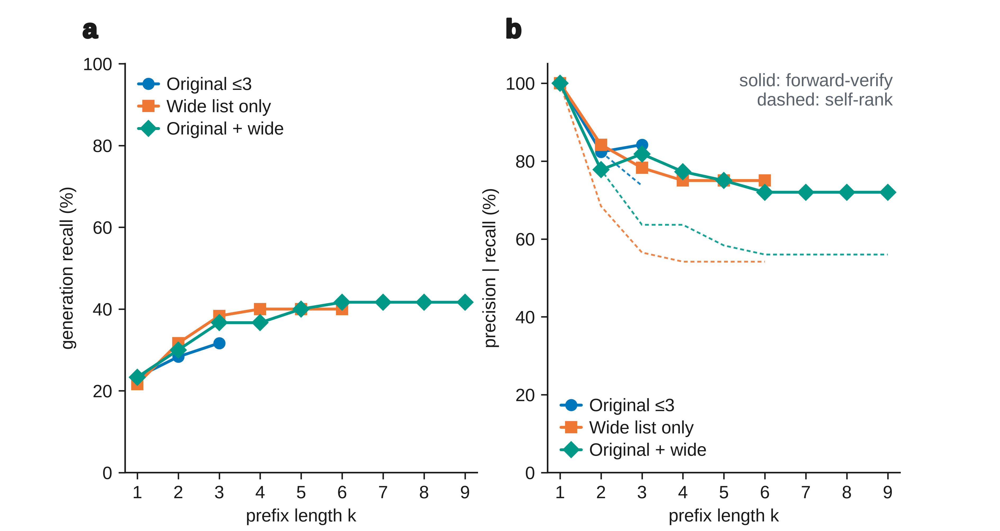
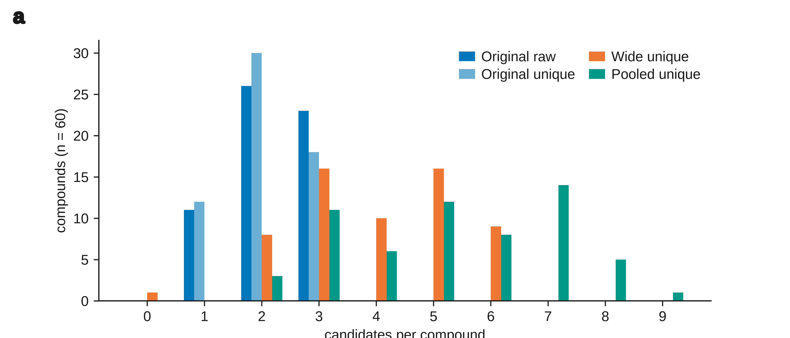

# Candidate budget and the generation wall

Reanalysis of ICLR 2027 submission 48823 (IRSpectra-Bench). No model was called. Every integer below is recomputed from deposited candidate lists, forward-prediction logs, and answer keys. Wilson intervals are 95%. Rows in `k_curve.csv` with `n_lists_ge_k = 0` repeat the full stored pool and are flagged `identified = false`. They are not measurements at that k.

## Verdict

**The generation-wall claim holds inside every deposited budget, with caveats that weaken it as a statement about pool size.** Generation misses still outnumber ranking misses at the longest stored list. The gap narrows as k grows, forward-verify top-1 on the n=500 headline falls as the prefix grows from 1 to 3, and k = 10, 20, and 50 are not in the logs. Generate-wide did not isolate pool size.

At k = 1, precision given recall is 1 by construction: a one-candidate pool that contains the truth has nothing else to rank. That mechanical fact is real, and it is why a budget of “up to 3” inflates precision given recall relative to a longer list. It does not, by itself, create the n=500 headline. On that set only 29 of 249 recall hits are singletons, and self-rank precision on the other 220 is still 198/220.

## What “generation wall” means here

A miss is a generation miss when the true constitution is absent from the candidate pool, and a ranking miss when it is present and the ranker (self-rank or forward-verify) does not place it first. Top-1 = recall × precision|recall, so precision|recall = top-1 / recall whenever recall is positive. Generation dominates ranking when generation misses exceed ranking misses.

The locked headline, reproduced here from the raw top-3 scorer, is top-1 227/500, recall 249/500, self-rank precision|recall 227/249. The forward-verify wall on the same 500, also reproduced, is 204 verified, 45 misranked, 251 never proposed.

## The n=60 figure of 2.20

Reviewers MVmY and ndRh cite a mean of 2.2 Claude candidates on n=60. That figure is exact, and it is the raw list length, not the count of distinct constitutions.

Source: `data/benchmark_v3/predictions2.jsonl` (40 compounds) and `data/benchmark_v2_ctrl/predictions2.jsonl` (20). This is the same length `scripts/cross_vendor_budget.py` averages.

| length | sum | n | mean | median | histogram |
|---|---:|---:|---:|---:|---|
| raw strings | 132 | 60 | 132/60 = 2.20 | 2 | 1: 11; 2: 26; 3: 23 |
| unique canonical SMILES | 126 | 60 | 126/60 = 2.10 | 2 | 1: 12; 2: 30; 3: 18 |

No list is longer than 3. Eleven compounds returned one string; twenty-six returned two; twenty-three returned three. Six raw slots are duplicate or unparseable, which is the gap between 132 and 126.

The same 2.20 is not the n=500 headline budget. On the locked 500 (194 + the +106 expansion + the expand-500 200-cut), raw length sums to 1325/500 = 2.65 (median 3; histogram 1: 34, 2: 107, 3: 359). Unique constitutions sum to 1266/500 = 2.532 (median 3; histogram 0: 2, 1: 55, 2: 118, 3: 325). The longest raw list in the 500 is 3.

## What Generate-wide measured

`docs/ESI.md` states the candidate budget as three ranked SMILES, best first, in every arm except generate-wide, where ten agents each proposed up to six regiochemistry-aware candidates and the pools were merged. Scoring of the ordinary arms reads the first three. Generation recall of generate-wide reads the merged pool.

The deposited Opus wide lists are `data/gw/raw/g1.json`–`g10.json`. They cover 59 of the 60 compounds. `g5.json` has five keys and omits `V3-R27`. That compound stays in the denominator with an empty wide list. The prompt text that would say whether wide-list order is a confidence order is not in the repo. Prefixes of the wide list are therefore file order. Prefixes of the pooled list put the original ranked list first and append wide candidates in file order only after that list is exhausted.

`scripts/score_generate_wide.py`, rerun for this report, reproduces the published endpoint on the raw-string union: recall 25/60, forward-verify top-1 18/60, self-rank top-1 14/60, precision|recall 18/25. Every selected candidate at that endpoint has a forward prediction (`selected_unpredicted = 0`), which is the coverage-gap closure in `data/fverify_gw/`.

Unique-pool sizes on the same 60:

| pool | sum of unique SMILES | mean | median | min | max | notes |
|---|---:|---:|---:|---:|---:|---|
| original | 126 | 2.10 | 2 | 1 | 3 | the ≤3 protocol |
| wide list only | 238 | 3.97 | 4 | 0 | 6 | the 0 is `V3-R27`; 238/59 = 4.03 on the lists that exist |
| original, then wide | 318 | 5.30 | 5 | 2 | 9 | longest stored LLM pool |

Nine compounds have a wide list of 6. One pooled compound reaches 9. None reach 10.

Generate-wide therefore changed the prompt, the agent, and the pool, and then unioned the new lists with the original lists. A reader cannot attribute the published 19/60 → 25/60 recall lift to pool size alone. The truncation below is what can be separated without a new call.

## Recall and precision|recall against k

Prefix k keeps the first k distinct constitutions in the order defined above. Shorter lists contribute their whole list. Forward-verify re-ranks that prefix by the symmetric ¹³C chamfer (`scripts/specmetrics.py`); unpredicted candidates score 999 and lose to any predicted candidate; tied distances keep the earlier position. Self-rank reads position 0. k = 10, 20, and 50 are omitted from the tables because `n_lists_ge_k = 0` for every arm.

### n=60, three ways of reading the stored lists

Forward-verify and self-rank top-1 are numerators. Recall is the shared denominator of precision|recall.

| pool | k | lists with ≥k unique | recall | self-rank top-1 | self precision\|recall | forward-verify top-1 | fv precision\|recall | generation misses | self rank misses | fv rank misses |
|---|---:|---:|---:|---:|---:|---:|---:|---:|---:|---:|
| original | 1 | 60/60 | 14/60 | 14/60 | 14/14 | 14/60 | 14/14 | 46 | 0 | 0 |
| original | 2 | 48/60 | 17/60 | 14/60 | 14/17 | 14/60 | 14/17 | 43 | 3 | 3 |
| original | 3 | 18/60 | 19/60 | 14/60 | 14/19 | 16/60 | 16/19 | 41 | 5 | 3 |
| wide file order | 1 | 59/60 | 13/60 | 13/60 | 13/13 | 13/60 | 13/13 | 47 | 0 | 0 |
| wide file order | 3 | 51/60 | 23/60 | 13/60 | 13/23 | 18/60 | 18/23 | 37 | 10 | 5 |
| wide file order | 5 | 25/60 | 24/60 | 13/60 | 13/24 | 18/60 | 18/24 | 36 | 11 | 6 |
| wide file order | 6 | 9/60 | 24/60 | 13/60 | 13/24 | 18/60 | 18/24 | 36 | 11 | 6 |
| original + wide | 1 | 60/60 | 14/60 | 14/60 | 14/14 | 14/60 | 14/14 | 46 | 0 | 0 |
| original + wide | 3 | 57/60 | 22/60 | 14/60 | 14/22 | 18/60 | 18/22 | 38 | 8 | 4 |
| original + wide | 5 | 40/60 | 24/60 | 14/60 | 14/24 | 18/60 | 18/24 | 36 | 10 | 6 |
| original + wide | 6 | 28/60 | 25/60 | 14/60 | 14/25 | 18/60 | 18/25 | 35 | 11 | 7 |
| original + wide | 9 | 1/60 | 25/60 | 14/60 | 14/25 | 18/60 | 18/25 | 35 | 11 | 7 |

The original k = 3 row is the published 60-compound arm: recall 19/60 (31.7%; 21.3–44.2), forward-verify precision|recall 16/19 (84.2%; 62.4–94.5), self-rank precision|recall 14/19. Six of those 19 recall hits are singletons, so the multi-candidate conditional rates are (16−6)/(19−6) = 10/13 forward-verify and (14−6)/(19−6) = 8/13 self-rank, matching the published multi-candidate column.

At a matched prefix of 3, the wide file-order list recalls 23/60 against the original list’s 19/60. Part of the published lift is already present before the lists are unioned and before k exceeds 3. That comparison uses file order for the wide arm.

The union reaches the published recall of 25/60 at prefix 6 and does not move at prefixes 7, 8, or 9. Forward-verify top-1 is 18/60 at k = 3, 17/60 at k = 4, and 18/60 from k = 5 through k = 9. The path is not monotone: lengthening the pool can hand the chamfer ranker a closer distractor. At the full union, no recall hit is a singleton, so 18/25 (72.0%; 52.4–85.7) is a real choice. Generation misses are 35 and forward-verify ranking misses are 7.





### Headline n=500, prefix of the deposited ≤3 lists

Self-rank uses the raw strings in list order, capped at three, which is the scorer behind 227/500 and 249/500. Forward-verify uses the deposited candidate rows ordered by `self_rank` and the stored ¹³C predictions (locked 194 from `data/fverify/` and `data/fverify_main/`; +106 from `data/fverify_expand/`; 200-cut from `data/fverify_expand_500/`, read from git `473030fb9d046548ff1ad06d04d20915fc2943d2`). Both scorers agree on the full-pool integers.

| k | lists with ≥k unique | recall | self-rank top-1 | self precision\|recall | forward-verify top-1 | fv precision\|recall | generation misses | self rank misses | fv rank misses | recall singletons |
|---:|---:|---:|---:|---:|---:|---:|---:|---:|---:|---:|
| 1 | 498/500 | 227/500 | 227/500 | 227/227 | 227/500 | 227/227 | 273 | 0 | 0 | 227 |
| 2 | 443/500 | 243/500 | 227/500 | 227/243 | 217/500 | 217/243 | 257 | 16 | 26 | 29 |
| 3 | 325/500 | 249/500 | 227/500 | 227/249 | 204/500 | 204/249 | 251 | 22 | 45 | 29 |

Self-rank top-1 stays 227 while recall moves from 227 to 249. Forward-verify top-1 falls from 227 to 204. The second and third candidates add 22 generation rescues and, under chamfer, add more ranking errors than rescues. At the full k ≤ 3 pool the wall is 251 generation misses against 22 self-rank misses and 45 forward-verify misses (204 + 45 + 251 = 500).

Singleton arithmetic at k = 3: 29 of 249 recall hits have a one-candidate pool. Self-rank precision on the rest is (227−29)/(249−29) = 198/220. Forward-verify precision on the rest is (204−29)/(249−29) = 175/220.

The three slices at their own full pools, forward-verify:

| slice | recall | self-rank top-1 | forward-verify top-1 | generation misses | fv rank misses |
|---|---:|---:|---:|---:|---:|
| locked 194 | 65/194 | 55/194 | 58/194 | 129 | 7 |
| +106 | 68/106 | 63/106 | 56/106 | 38 | 12 |
| expand-500 200-cut | 116/200 | 109/200 | 90/200 | 84 | 26 |
| n=500 | 249/500 | 227/500 | 204/500 | 251 | 45 |

### Other deposited models, same 60 compounds

Lists are in `sweep_out/`. Truth is joined from `sweep_prompts/solve_*.md` onto `benchmark_v3` and `benchmark_v2_ctrl` by formula, IR, and ¹³C. The two rounds reuse qid strings, so the directory is part of the key. Forward-verify uses a rebuilt anonymous map (canonical SMILES, seed 5, the construction in `scripts/cross_vendor_sweep.py`). It is reported only where it reproduces the published conditional count.

| model | raw sum | unique sum | unique mean | k=1 recall = self top-1 | k=3 recall | k=3 self precision\|recall | k=3 fv precision\|recall | generation misses at k=3 | fv rank misses at k=3 |
|---|---:|---:|---:|---:|---:|---:|---:|---:|---:|
| Claude original | 132 | 126 | 2.10 | 14/60 | 19/60 | 14/19 | 16/19 | 41 | 3 |
| grok-4.6 | 180 | 178 | 2.97 | 23/60 | 32/60 | 23/32 | 20/32 | 28 | 12 |
| grok-4.6 clean clone | 180 | 170 | 2.83 | 19/60 | 28/60 | 19/28 | no verify log | 32 | — |
| gemini-3.7-flash | 180 | 176 | 2.93 | 23/60 | 30/60 | 23/30 | 22/30 | 30 | 8 |
| gpt-5.6-sol | 180 | 180 | 3.00 | 21/60 | 25/60 | 21/25 | 17/25 | 35 | 8 |
| composer-2.5 | 169 | 155 | 2.58 | 10/60 | 12/60 | 10/12 | no verify log | 48 | — |
| gpt-5.6-luna | 180 | 156 | 2.60 | 6/60 | 9/60 | 6/9 | no verify log | 51 | — |

Grok, Gemini, and Sol were asked for three and usually returned three distinct structures. Their generation misses still exceed their forward-verify ranking misses (28 > 12, 30 > 8, 35 > 8). Grok is the closest call: forward-verify precision|recall is 20/32 (62.5%; 45.3–77.1) against recall 32/60 (53.3%; 40.9–65.4). That is the same arm whose paired gap the paper already reported as directional.

The 24-compound ladder (`scripts/score_models.py` subset) reproduces `data/benchmark_main/model_comparison.json`: Opus 6/24 top-1 and 7/24 recall, Sonnet 5/24 and 6/24, Haiku 0/24 and 1/24, Fable 11/24 and 13/24. Raw means on those 24 are Opus 57/24 = 2.375, Sonnet 53/24 = 2.208, Haiku 48/24 = 2.00 (every list length 2), Fable 63/24 = 2.625. No forward-verify log exists for this subset.

Sonnet’s generate-wide file (`data/gw/raw/sonnet_b1.json`, `sonnet_b2.json`) covers 12 compounds, unique sum 41, mean 3.42, max 5. Full-list recall is 4/12, matching `data/gw/crossmodel.txt`. Self-rank top-1 is 2/12. There is no forward-verify map for these 12.

## What is missing, and the command that would identify it

No deposited LLM candidate list has length 10 or more. k = 10, 20, and 50 are unidentified. Copying the k = 6 or k = 9 result into those columns would invent the curve. `k_curve.csv` leaves them flagged `identified = false` for that reason.

Also absent:

- The generate-wide instruction text. File order is what the JSON contains. A confidence order for those six slots was not stored.
- `V3-R27` in `data/gw/raw/`. The published 60-compound denominator still includes it, via its original list.
- DeepSeek V4 Pro and Nemotron replies. `docs/MODELS.md` points at `data/cross_vendor/`, which is gitignored and not present in this checkout.
- Beam order for the trained generator. `contrib/generator_probe/artifacts/gen_candidates.jsonl` holds 248 qids and 8344 sorted canonical SMILES (mean 33.65, median 35, max 40). The sort destroys rank, so a prefix of that file is not a k curve. Formula filtering, which the published generator-pool numbers use, was not reapplied here.
- An exhaustive formula-constrained isomer pool stored as a candidate list. `scripts/closing_the_gap.py` can enumerate; this report does not substitute that enumeration for a missing LLM list.

Local command that regenerates this report’s tables from the deposits:

```bash
git fetch origin cursor/fverify-n500-unify-629c
python3 analysis/iclr_rebuttal_nov2026/k_sweep/k_sweep.py
```

The n=60, n=194, and generate-wide blocks read the working tree. The n=500 expansion block reads git `473030fb9d046548ff1ad06d04d20915fc2943d2` (`origin/cursor/fverify-n500-unify-629c` at the time of the run), which contains the expansion questions, predictions, and forward-verify logs. A clone that has not fetched that commit skips the n=500 block instead of inventing it. The script checks 21 published integers before it exits 0, including 25/60 and 18/25, 19/60 and 16/19, 65/194 and 58/194, 227/500 and 249/500, and 204/45/251.

A run that would identify k = 5, 10, 20, and 50 under one generation condition was not started. The design that matches the reviewers’ question is a single ask for 50, best first, on a fixed subset, then prefix truncation to 5, 10, 20, and 50. The deposited prompt (`sweep_prompts/solve_01.md`, and `K = 3` in `scripts/cross_vendor_sweep.py`) asks for 3. Changing that string and `K`, solving the same 60 compounds in fresh batches of 6, and storing the JSON is the whole experiment. Truncation after the fact is then `k_sweep.py`. Doing it on all 500 is the same protocol with a larger denominator. Neither call was made.

Token counts are not in the generate-wide logs, so a price is not a measurement. Using the rebuttal pack’s assumptions only as a sketch — about 1,500 input tokens per task, and the 7 October 2026 Opus list price of $5 per million input tokens and $25 per million output tokens — input for 60 tasks is about $0.45. Output at that pack’s 2,000 / 8,000 / 15,000 token scenarios is about $3 / $12 / $22.50. A 500-task pass scales those figures by 500/60. Those are not invoices, and a k = 50 answer may think longer than a k = 3 answer.

## Paste-ready reviewer comment

The 2.20 figure is exact for the 60-compound arm: the raw candidate lists sum to 132/60 (median 2; 11 lists of length 1, 26 of length 2, 23 of length 3). Distinct constitutions sum to 126/60 = 2.10. It is not the budget on the n=500 headline, where raw length sums to 1325/500 = 2.65 (median 3) and no list is longer than 3.

We recomputed recall and precision|recall by truncating the stored lists. No new model call. At k = 1, precision|recall is 227/227 on the 500 and 14/14 on the 60, because a one-candidate pool cannot be misranked. At the deposited k ≤ 3 pool, the 500 splits into 251 generation misses, 22 self-rank misses, and 45 forward-verify misses (204 verified + 45 misranked + 251 never proposed = 500). Self-rank precision|recall is 227/249 = 91.2%. Only 29 of those 249 recall hits are singletons; on the other 220, self-rank precision is 198/220 and forward-verify precision is 175/220. Forward-verify top-1 falls from 227/500 at k = 1 to 204/500 at k = 3, so the extra slots are not free for the chamfer ranker.

Generate-wide did not isolate pool size. It used a second prompt (up to six regiochemistry-aware candidates), a second set of agents, and a union with the original lists. The deposited wide files cover 59/60 compounds (`V3-R27` is absent). Truncating the union, which is the longest stored LLM pool (mean 5.30 unique structures, max 9), moves the 60-compound arm from recall 19/60 and forward-verify precision|recall 16/19 to recall 25/60 and 18/25. Generation misses go from 41 to 35; forward-verify ranking misses go from 3 to 7. The inequality remains. It is narrower, and the wide-only file-order prefix of 3 already recalls 23/60, so part of the published lift is not a pure budget effect. The wide-list order is the order written in `data/gw/raw/`; the prompt that would establish it as a confidence order was not retained.

The same 60 compounds, for models that returned about three distinct structures, still show more generation misses than forward-verify ranking misses: Grok 28 vs 12 (precision|recall 20/32), Gemini 30 vs 8 (22/30), GPT-5.6 Sol 35 vs 8 (17/25). Grok remains the narrow margin.

k = 10, 20, and 50 are not identified. No stored list is that long, and we do not draw a curve past the stored maximum. A single 50-candidate generation on this 60, truncated to 5, 10, 20, and 50, is the experiment that would answer the question under one protocol. It has not been run.

## Methods / Results insert

**Methods.** Candidate-budget sensitivity uses only deposited lists. For each compound the pool is the first k distinct canonical SMILES in list order. On the ordinary arms that order is the model’s rank, best first. On generate-wide, original candidates stay in their stored rank and wide candidates are appended in the order written in `data/gw/raw/`. Recall is the fraction of compounds whose true InChIKey connectivity block falls in the prefix. Precision|recall is the fraction of those compounds on which the ranker places the truth first. The ranker is either position 0 or a re-sort of the prefix by symmetric ¹³C chamfer against the observed shifts. Compounds with fewer than k candidates contribute the list they have. No list in the release reaches length 10, so k = 10, 20, and 50 are unmeasured.

**Results.** On the 60-compound arm Claude’s raw lists average 132/60 = 2.20 candidates (median 2). The n=500 lists average 1325/500 = 2.65 (median 3; maximum 3). At that full prefix the 500 yields recall 249/500, self-rank precision|recall 227/249, and forward-verify precision|recall 204/249, i.e. 251 generation misses against 22 self-rank misses and 45 chamfer misses. Extending the same 60 by the stored generate-wide union (mean 5.30 unique structures, maximum 9; one compound, V3-R27, has no wide list) raises recall from 19/60 to 25/60 and lowers forward-verify precision|recall from 16/19 to 18/25. Generation misses remain the larger class, 35 against 7. Across Grok, Gemini, and GPT-5.6 Sol, each at its deposited length of about 3, generation misses likewise remain larger than chamfer ranking misses (28 vs 12, 30 vs 8, and 35 vs 8). The gap is narrowest for Grok. These truncations describe the lists that were returned under an ask for 3 or an ask for 6. They do not substitute for a run that was asked for 10, 20, or 50.
